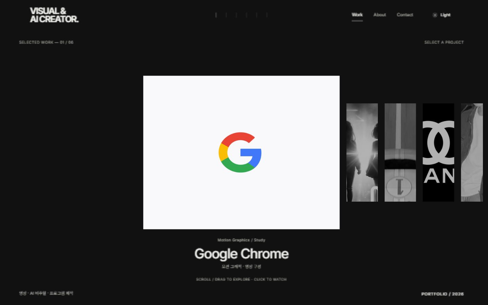
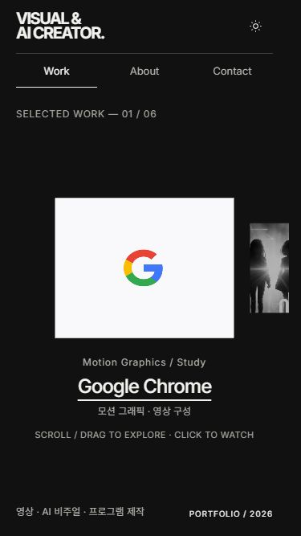
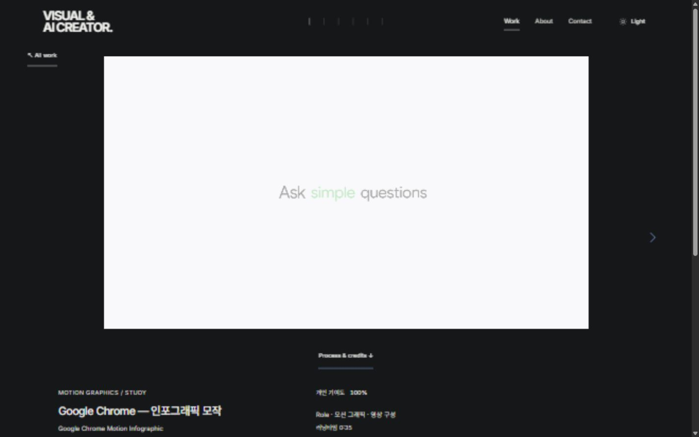
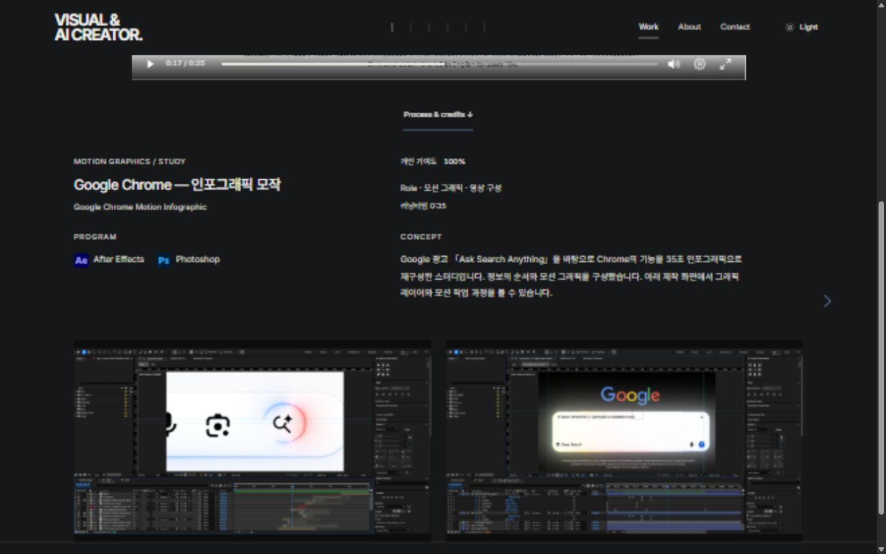
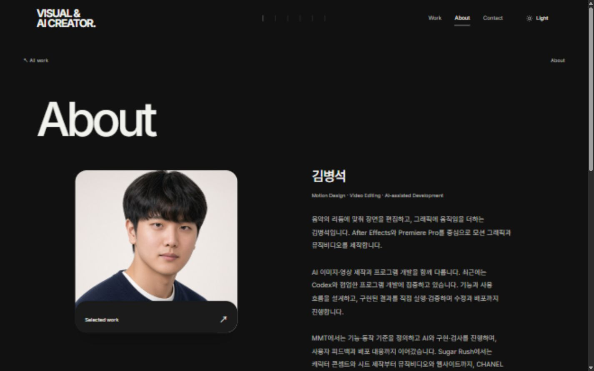
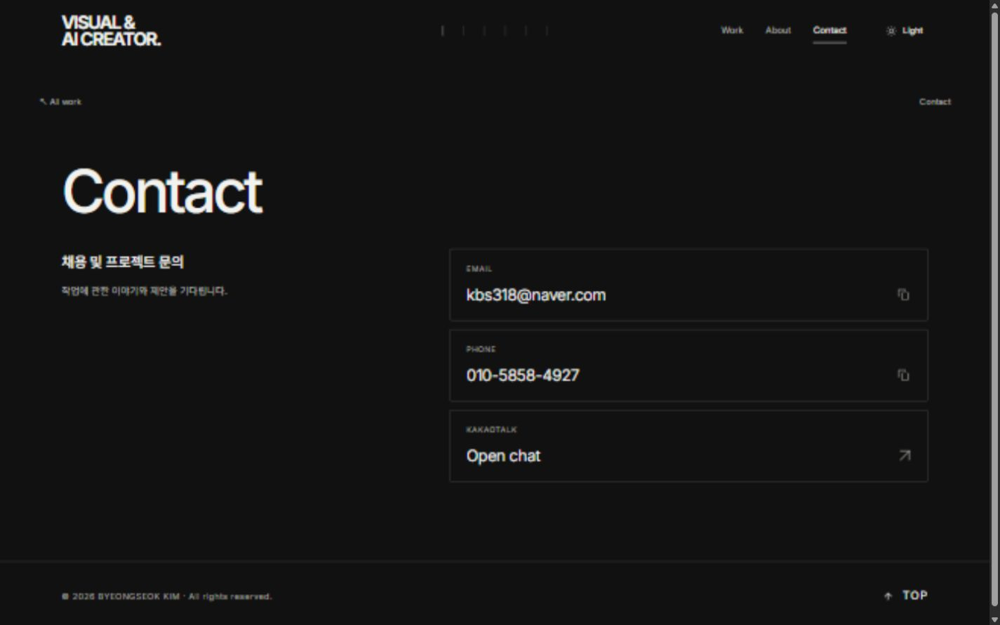
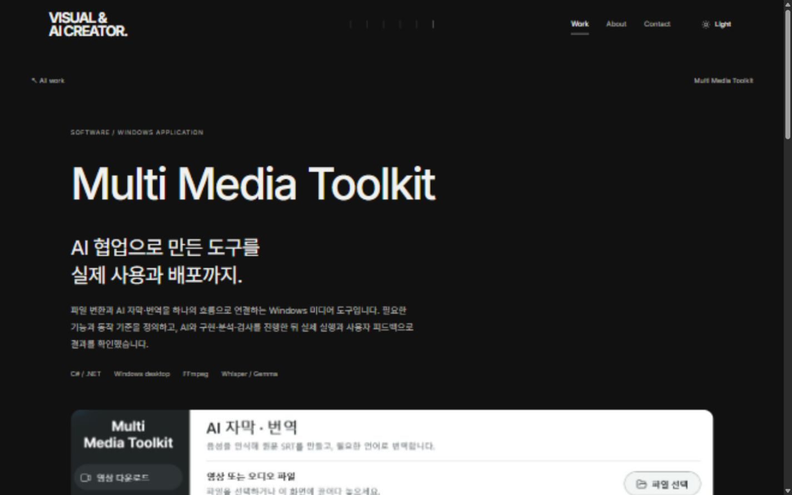
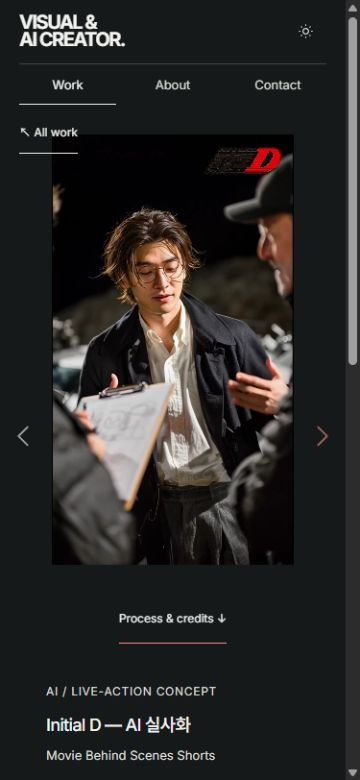

# 포트폴리오 사이트 검토 · 2026-10-21

## 판단

영상·AI 비주얼·프로그램 프로젝트를 함께 보여주는 개인 포트폴리오로 적합하다. 작품 중심의 첫 화면, 작품별 타이포 연출, 제작 과정과 개인 역할, 실제 프로그램 사례가 연결되어 있다. 다만 첫인상은 영상 쪽으로 기울어 있으며, 사이트의 시각적 완성도만으로 전문 UI/UX 설계 역량까지 입증되지는 않는다.

이번 평가는 현재 로컬 사이트를 직접 조작하고 촬영한 화면에 근거한다. 실제 채용 담당자의 반응이나 전환율을 측정한 결과는 아니다.

## 확인한 흐름

| 단계 | 화면·행동 | 상태 | 판단 |
| --- | --- | --- | --- |
| 1 | 첫 화면에서 작품 탐색 | 양호 / 전달력 보완 | 중심 카드와 주변 카드로 탐색 방향이 드러난다. 그러나 프로그램 프로젝트가 마지막에 있어 첫 화면만 보고는 영상 중심 포트폴리오로 받아들일 수 있다. |
| 2 | 작품 선택 → 타이포 → 영상 | 양호 / 시간 비용 존재 | 작품별 연출이 차별점을 만든다. 반복 탐색 시 매번 인트로를 기다리는 비용은 있다. 현재 승인된 연출은 유지했다. |
| 3 | 영상 → Process & credits → 제작 과정 | 양호 / 설명 보완 | 영상과 제작 자료가 연결된다. 역할·기여도·도구가 보인다. 각 작품에서 어떤 선택을 왜 했고 무엇을 해결했는지 더 구체적으로 쓰면 판단 근거가 강해진다. |
| 4 | MMT 프로그램 사례 | 양호 / 결과 노출 보완 | 실제 앱 화면, 기획·AI 협업·검증·수정·배포 과정이 있어 개발 경험의 근거가 된다. 첫 화면에서는 긴 소개 뒤에 앱 화면의 일부만 보여 결과 파악이 느릴 수 있다. |
| 5 | About | 보통 | 프로필과 소개가 영상·AI·개발을 연결한다. 많은 도구 이름은 경험 범위를 보여주지만 숙련도를 설명하지는 못한다. 실제 역량 판단의 중심은 프로젝트 사례가 되어야 한다. |
| 6 | Contact | 양호 | 연락 목적과 수단이 분명하다. 실제 이메일 전송·외부 채팅은 실행하지 않았다. |

## UI·웹 디자인 평가

- **좋은 점:** 작품을 크게 보여주는 구조, 절제된 기본 색상, 작품별 개성, 단순한 상단 메뉴가 포트폴리오의 목적과 맞는다. 흔한 서비스 대시보드형 구성보다 작업물을 기억하게 하는 장점이 있다.
- **남은 약점:** 메인 주변 정보의 작은 글씨, About의 정보량, MMT 첫 화면의 긴 소개가 빠른 훑어보기를 방해할 수 있다. 동적인 메인은 정적인 목록보다 처음 배우는 비용도 있다.
- **정체성:** `Visual & AI Creator.`는 영상과 AI 기반 제작을 함께 담는 방향에 맞다. 이 문구만으로 프로그램 제작까지 모두 설명하기는 어려워 `영상 · AI 비주얼 · 프로그램 제작`을 함께 표시했다.
- **전문 UI/UX 포트폴리오로서:** 시각·인터랙션 감각을 보여주는 자료로는 사용할 수 있다. UI/UX 직무를 직접 겨냥한다면 대상 사용자, 문제, 정보 구조, 설계 선택, 검증과 수정의 근거가 담긴 사례가 별도로 필요하다.

## 다음 개선의 우선순위

1. **빠른 역량 파악:** 각 프로젝트 설명의 첫 문장에서 결과물과 담당 범위를 구체적으로 드러낸다. 도구 이름을 더 늘리는 것보다 효과가 크다.
2. **작업의 판단 근거:** 영상에는 편집·리듬·타이포 선택의 이유를, 프로그램에는 문제·동작·검증·수정의 사례를 짧게 제시한다. 확인하지 않은 성과 수치나 숙련도는 추가하지 않는다.
3. **분야의 균형:** 기존 카드 구조와 순서는 유지하되, 프로그램 프로젝트가 있다는 사실을 첫 화면의 보조 문구와 카드 정보로 알린다. 현재 프로그램 사례는 MMT 하나이므로 영상과 동일한 폭의 경험이 있다고 단정할 수는 없다.

## 이번에 반영한 수정

- 헤더와 소개의 명칭을 `Visual & AI Creator.`로 정리했다.
- 짧은 창에서 메인 카드·제목·하단 문구가 겹치지 않도록 높이 기준을 조정했다.
- 작은 화면의 메뉴를 두 줄로 배치하고, About·Contact·프로그램 설명은 폭에 맞춰 한 열로 전환했다.
- 모바일 프로필 설명이 잘리지 않도록 카드 높이가 내용에 따라 늘어나게 했다.
- 영상의 시작 위치를 헤더 높이와 연결하고 세로 영상의 높이를 화면에 맞췄다.
- MMT에는 영상용 화살표 여백을 적용하지 않도록 수정했다.

## 검증 범위

브라우저 화면 크기 320·375·768·1024·1440px 및 667×375 가로 화면에서 주요 배치를 확인했다. Google Chrome 영상 진입·재생, 제작 과정 이동 시 정지, About·Contact 이동, MMT 상세 진입, Initial D 세로 영상 진입과 재생을 확인했다. 최종 자동 점검 60개와 변경 파일 형식 점검이 통과했다.

실물 스마트폰 터치·Safari·스크린리더·저속 네트워크·외부 연락 전송은 확인하지 않았다. 전체 영상의 화질이나 콘텐츠 자체의 완성도를 프레임별로 평가한 검토는 아니다.

## 현재 검토 화면

### 첫 화면

### 작은 화면

### 영상과 제작 과정

### About·Contact·프로그램

